# Evaluating LLM-Generated SystemVerilog Assertions Through Mutation-Based Design Verification

<p align="center">
  <strong>APB Programmable Timer · SystemVerilog Assertions · Mutation Testing · Synopsys VCS / URG / Verdi</strong>
</p>

<p align="center">
  <a href="#key-results">Results</a> ·
  <a href="#verification-architecture">Architecture</a> ·
  <a href="#mutation-campaign">Mutation Campaign</a> ·
  <a href="#coverage-and-vacuity">Coverage</a> ·
  <a href="#waveform-debugging-case-studies">Debugging</a> ·
  <a href="#reproducing-the-experiments">Reproduce</a>
</p>

> **Research question:** Can an LLM-generated assertion suite pass a correct RTL implementation and still miss real, externally observable design defects?
>
> **Finding:** Yes, under the checker contracts and stimulus used here. Both white-box suites detected all 10 activated mutants; the original port-only GPT and Claude suites detected **1/9** and **2/9** mutants, respectively, among those observable at the chosen sampling points. These are results from **one controlled case study**, not a general ranking of models.

## Key results

| Measurement | Result |
|:--|:--|
| Design under test | Memory-mapped APB programmable timer |
| Frozen specification | [APBTMR-SPEC v1.0](spec/APBTMR_SPEC_v1.0.md) |
| Stimulus | **81 tests, 8,348 vector cycles** |
| Defects | **10 intentional, single-defect RTL mutants** |
| Original white-box GPT / Claude | **10/10 / 10/10** activated mutants detected |
| Original black-box GPT / Claude | **1/9 / 2/9** port-observable mutants detected |
| Reference baseline | **0 reported assertion failures** in all four original checker suites |
| Supplemental port-only H1 / H2 | **M07 / M09 detected**; **6 / 14** failures on the target mutants |
| Tools | Synopsys **VCS Y-2026.03**, **URG**, **Verdi**; Python, Bash, Linux |

**Primary evidence:** [audited white-box matrix](mutation/results_validation/clkstart1ns_adjudicated/matrix.md) · [audited black-box matrix](mutation/blackbox/results/bb_matrix.md) · [H1/H2 validation logs](mutation/engineer_sva/results/) · [coverage screenshots](mutation/docs/evidence/coverage/).

## Why this project?

Simulation passing on a correct design shows that a checker can accept *one implementation under one stimulus set*. It does not prove that the checker would reject incorrect implementations. This project evaluates that missing dimension by deliberately introducing plausible RTL bugs and checking whether the generated assertions detect them.

The scope is deliberately controlled: **one APB timer specification, two model families, two checker contracts, ten injected defects, one fixed vector suite, and separate post-experiment assertions to investigate observed blind spots**.

## Verification architecture

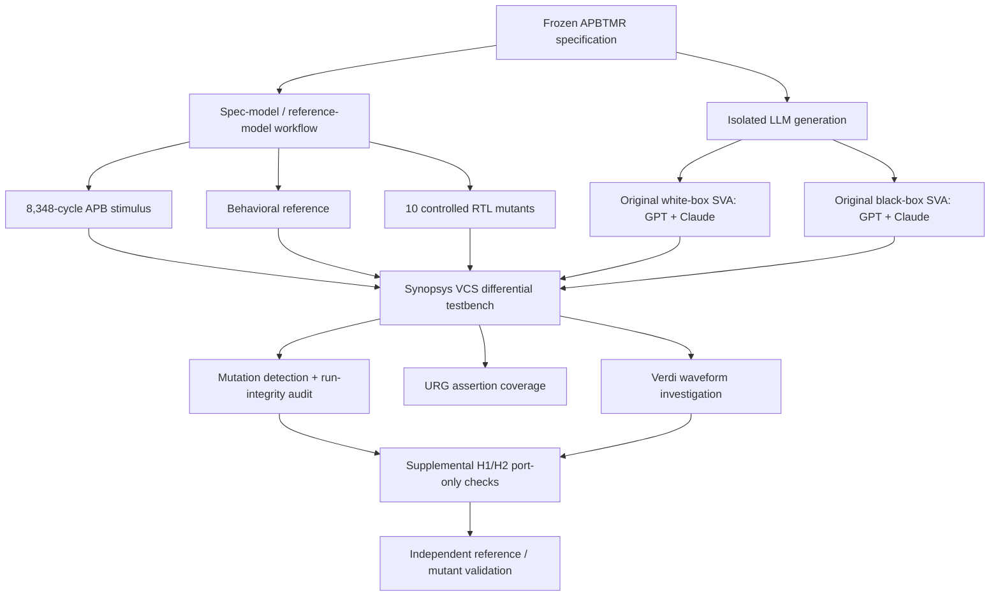

*Diagram shows the complete study, not a claim that the original LLM checkers and the reference were independently human-designed.*

### Timer design and observable interface

The DUT implements a register-mapped timer with programmable prescaling, periodic/one-shot operation, restart behavior and sticky interrupt status. Its externally accessible signals are:

`PCLK`, `PRESETn`, `PSEL`, `PENABLE`, `PWRITE`, `PADDR`, `PWDATA`, `PRDATA`, `PREADY`, `PSLVERR`, and `irq`.

| Offset | Register | Purpose |
|:--|:--|:--|
| `0x00` | `CTRL` | Enable, mode, interrupt enable, prescaler configuration |
| `0x04` | `LOAD` | Timer reload/shadow value |
| `0x08` | `COUNT` | Current timer counter |
| `0x0C` | `STATUS` | Pending and overflow status; write-one-to-clear |
| `0x10` | `CMD` | Restart command |
| `0x14` | `ACTIVE` | Active reload value |
| `0x18` | `PSCNT` | Prescaler phase/count readback |

The full timing, collision-priority, reset and read/write rules are defined in the [frozen specification](spec/APBTMR_SPEC_v1.0.md), rather than inferred from a DUT implementation.

### Two *different* checker contracts

| Dimension | White-box contract | Black-box contract |
|:--|:--|:--|
| Visibility | APB ports **and internal architectural state** | **11 external DUT ports only** |
| Internal `EN/PSC/COUNT/PCNT/PEND` | Observable | Not observable |
| Checker-local history | Allowed | Allowed if derived from ports |
| Procedural countdown / next-state model | Not restricted in the same way | Explicitly prohibited |
| Source | [GPT](gen/sva_gpt_1.sv), [Claude](gen/sva_claude_1.sv) | [GPT](mutation/blackbox/gen/sva_bb_gpt_1.sv), [Claude](mutation/blackbox/gen/sva_bb_claude_1.sv) |

**Experimental confound:** The two conditions differ in **visibility, generation prompt and modeling permissions**. The detection gap measures performance under these *contracts*, **not the causal effect of visibility alone**. Each condition has one generated checker set per model, without repeated samples.

## Experimental methodology

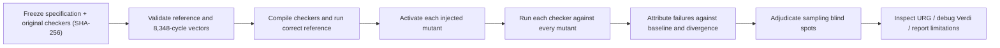

1. **Freeze:** Preserve first-pass generated files and prompts under SHA-256 manifests. Original checker sources are never silently patched.
2. **Baseline:** Run the correct reference with each checker. Record compilation, completed cycles, assertion failures and model/reference consistency.
3. **Activate:** Inject exactly one controlled defect per mutant and verify it causes a state and/or port divergence under the fixed stimulus.
4. **Detect:** Compare each mutant run's assertion failures with the corresponding clean reference run. An assertion *passing* the reference is not a detection.
5. **Audit:** Check run completion, checker binding, startup configuration, first detection, divergence attribution and any scoreboard sampling blind spots.
6. **Inspect:** Measure assertion exercise using VCS `-cm assert` / URG and debug representative misses and detections in Verdi.

The audited white-box flow used `+define+CLK_START_1NS` to eliminate a misleading time-zero clock-port event. The original testbench and audit documents record that investigation: [time-zero experiment](mutation/docs/TIME0_EXPERIMENT.md) and [clock-startup validation](mutation/docs/PHASE_B_CLKSTART1NS.md).

<details>
<summary><strong>Important audit detail: scoreboard sampling blind spots</strong></summary>

The scoreboard compares values once per vector row, while SVA evaluates at assertion clocking events. There are short windows around reset rows and two post-vector tail cycles that the scoreboard does not sample. Twenty additional white-box assertion failures in M08/M10 runs were individually adjudicated by replay against the specification model; none changed the **first detection** or the **10/10** outcome. These replay-based adjudications are disclosed separately from direct scoreboard observations.

See [attribution audit](mutation/docs/ATTRIBUTION_AUDIT.md) and [adjudicated failures](mutation/docs/ADJUDICATED_FAILURES.tsv).

</details>

## Mutation campaign

Each mutant alters **one intended behavior** in the reference-derived RTL. These are **injected faults, not discovered production RTL bugs**.

| ID | Injected defect | Port-divergent cycles | WB GPT | WB Claude | BB GPT | BB Claude |
|:--|:--|--:|:--:|:--:|:--:|:--:|
| M01 | PEND clear incorrectly beats expiration set | 28 | ✅ | ✅ | ❌ | ❌ |
| M02 | OVF checks post-clear PEND | 1 | ✅ | ✅ | ❌ | ❌ |
| M03 | Reload incorrectly uses same-cycle LOAD write | 14 | ✅ | ✅ | ❌ | ❌ |
| M04 | Software EN beats one-shot completion | **0** | ✅ | ✅ | N/O | N/O |
| M05 | Start treated as level-sensitive | 125 | ✅ | ✅ | ❌ | ❌ |
| M06 | Start preserves stale prescaler phase | 2 | ✅ | ✅ | ❌ | ❌ |
| M07 | Prescaler uses `==` instead of `>=` | 373 | ✅ | ✅ | ❌ | ❌ |
| M08 | Restart incorrectly requires EN | 40 | ✅ | ✅ | ❌ | ✅ |
| M09 | IE incorrectly gates PEND | 146 | ✅ | ✅ | ❌ | ❌ |
| M10 | IRQ incorrectly registered by one cycle | 159 | ✅ | ✅ | ✅ | ✅ |

**Legend:** ✅ detected · ❌ observable but missed · **N/O** no port divergence at the tested scoreboard sampling points. M04 is excluded from the black-box denominator, **not** counted as a miss. The white-box denominator includes all ten activated mutants.

### Detection-rate comparison

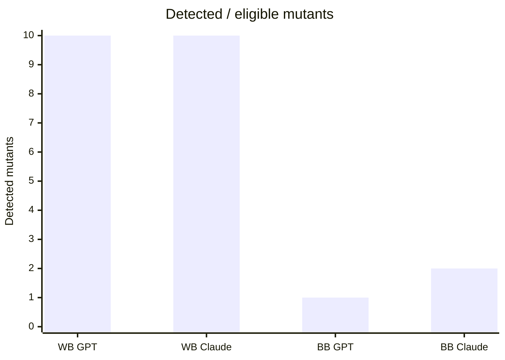

The chart shows **counts**, with denominators **10, 10, 9 and 9**, respectively. It is descriptive, not a statistically powered comparison. Read the [detailed detection matrix](mutation/blackbox/results/bb_matrix.md) for detection labels, cycles and latency.

## Coverage and vacuity

All figures below come from **VCS assertion coverage / Synopsys URG on the correct reference**, not functional covergroups and not formal proofs.

| Original checker | Assertions | With ≥1 real success | Without success | Reported incomplete |
|:--|--:|--:|--:|--:|
| GPT white-box | 25 | **25** | 0 | 10 |
| Claude white-box | 105 | **105** | 0 | 9 |
| GPT black-box | 20 | **18** | 2 | 0 |
| Claude black-box | 33 | **27** | 6 | 3 |

The Claude white-box checker also contains **11 cover properties**, all reached in the URG run. The incomplete counts are URG-reported incomplete attempts and are **not assertion failures**; their exact scheduling cause is not established here.

**Critical interpretation:** URG's approximately 8,351 attempts per assertion are not equivalent to 8,351 meaningful antecedent activations. A successful exercise does **not** establish that a property is strong enough to reject an incorrect implementation.

<details>
<summary><strong>Coverage screenshots (expand)</strong></summary>

**White-box GPT / Claude**

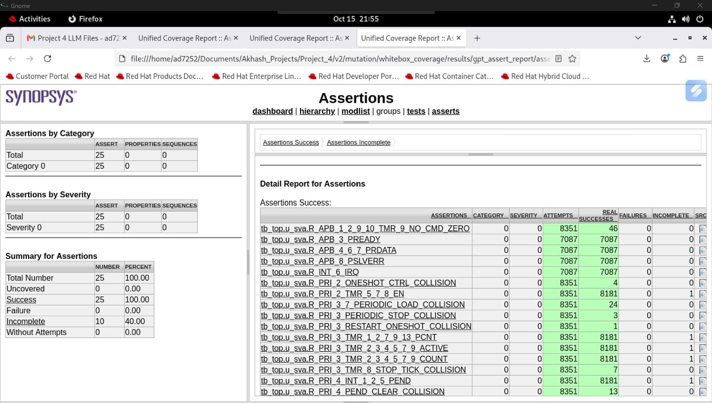

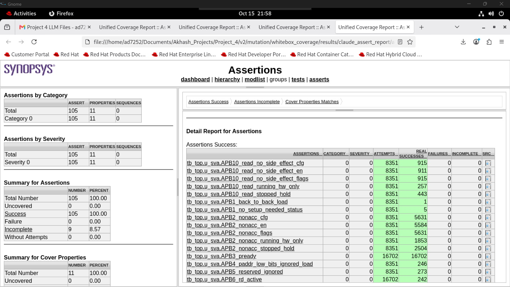

**Black-box GPT / Claude**

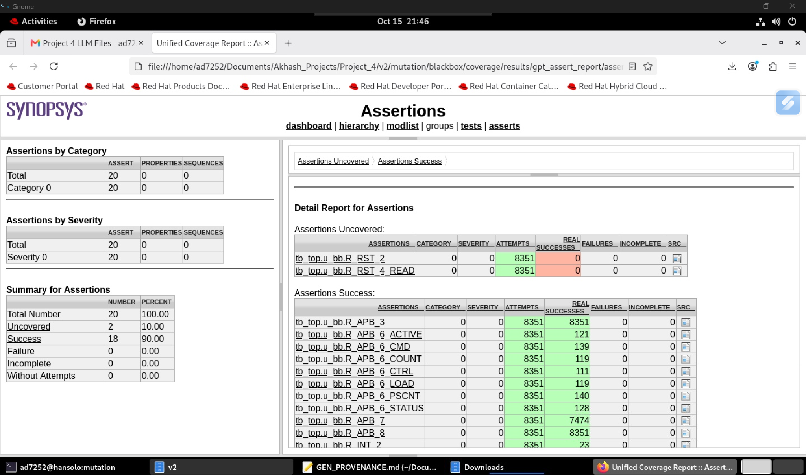

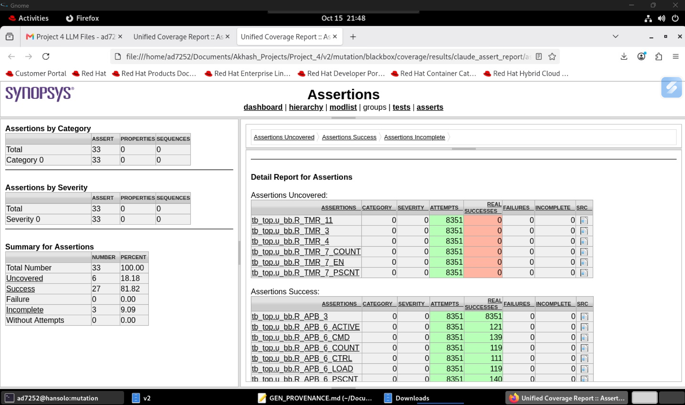

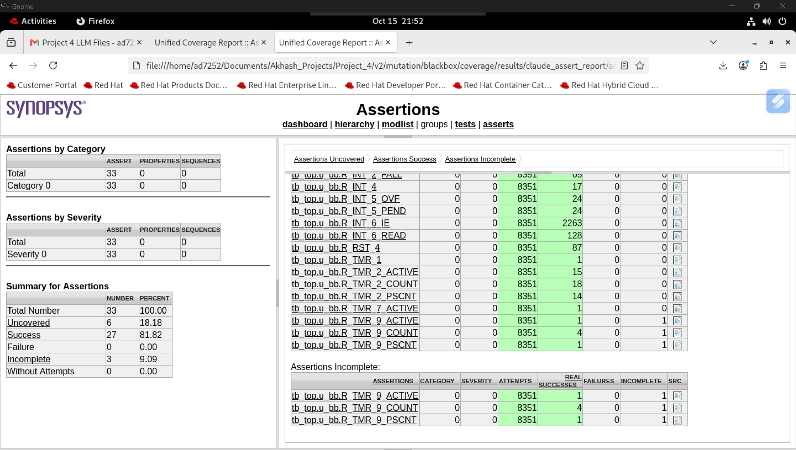

</details>

The **two GPT black-box properties with no successes** are `R_RST_2` and `R_RST_4_READ`. The **six Claude black-box properties with no successes** are `R_TMR_3`, `R_TMR_4`, `R_TMR_11`, `R_TMR_7_COUNT`, `R_TMR_7_EN`, and `R_TMR_7_PSCNT`. This agrees with the project's separate model-replay analysis; the URG measurements are the simulator-backed evidence.

## Waveform debugging case studies

### M07: Prescaler comparison misses a tick

**Fault:** `pcnt == psc` replaces the specified `pcnt >= psc`. If software lowers PSC after PCNT has passed the new threshold, an equality-only comparison can miss the expected tick.

**Verdi observation:** The mutant's PCNT continues past the threshold while the reference resets PCNT and advances the countdown. A later PEND/IRQ difference makes the internal timing error externally visible. M07 has **373 port-divergent sampled cycles**, yet neither original black-box checker detected it.

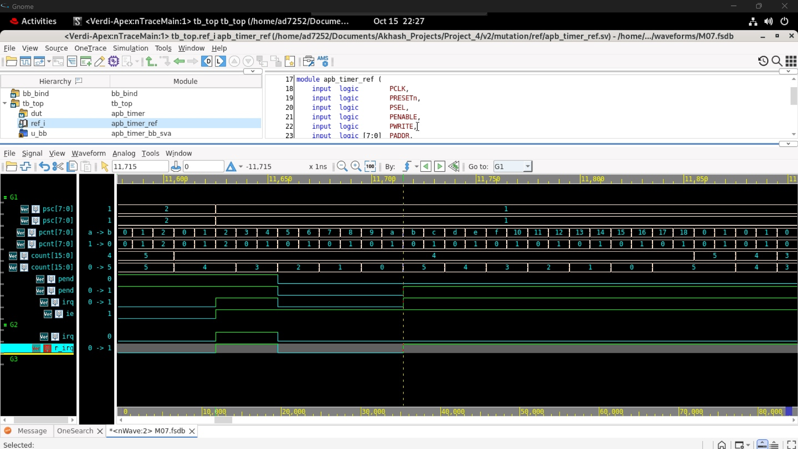

### M09: Interrupt enable incorrectly controls PEND

**Fault:** PEND is incorrectly set only when IE=1. The specification requires PEND to record expiration **even when interrupts are masked**; IE controls whether the pending event drives IRQ.

**Verdi observation:** The reference asserts PEND while IE=0; the mutant does not. After enabling IE, the reference IRQ asserts but the mutant IRQ remains low. A subsequent APB STATUS read shows the externally observable pending-flag readback mismatch. M09 has **146 port-divergent sampled cycles**, missed by both original black-box suites.

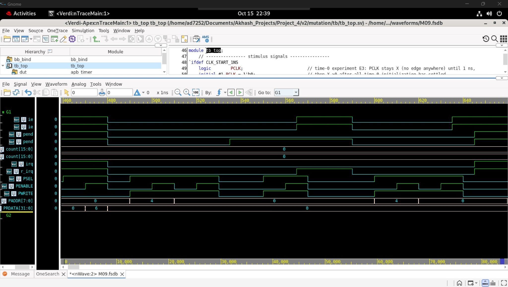

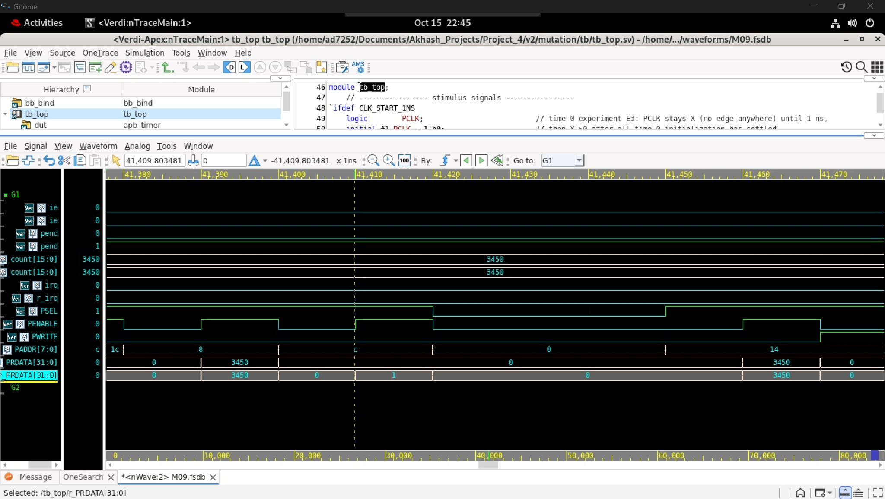

**Why a simple check missed it:** A property like `irq == PEND && IE` can still hold when **PEND itself is wrong**. Port consistency is weaker than independently checking *why* PEND should have been asserted. See the [M07/M09 root-cause investigation](mutation/blackbox/docs/RCA_M07_M09.md).

### M10: Registered IRQ violates combinational timing

**Fault:** The mutant registers IRQ rather than directly reflecting `PEND && IE`, introducing a clock-cycle delay.

**Verdi / VCS observation:** The white-box Claude `INT6_irq` assertion detected M10 at approximately **190 ns**, in the first divergent test cycle. The original black-box suites detected this mutant later under different port-only properties.

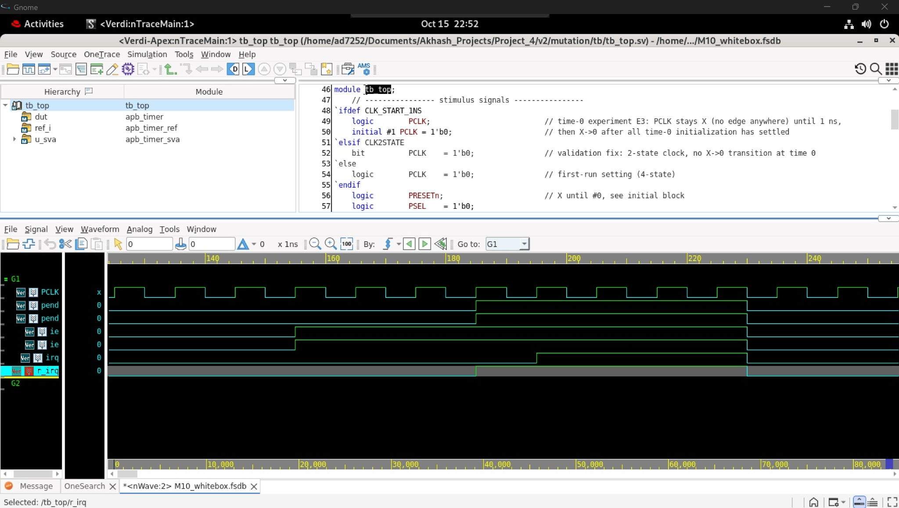

## Supplemental H1/H2: closing two observed gaps

After freezing and measuring the original four checker suites, two **AI-assisted, port-only supplemental assertions** were implemented separately. They are an **engineering follow-up**, not retroactively included in the LLM-generated checker scores.

| Property | Port-derived check | Target mutant | Correct reference | Mutant |
|:--|:--|:--|:--|:--|
| `H1_prescaler_bound` | Guarded PSCNT readback does not exceed tracked PSC | M07 | **0 failures; 62 real successes** | **6 failures** |
| `H2_pending_mask_independence` | Known one-shot expiration followed by IE enable must assert IRQ | M09 | **0 failures; 31 real successes** | **14 failures** |

The combined H1/H2 reference run completed **8,348 vector cycles** with no specification mismatches and no reported assertion failures.

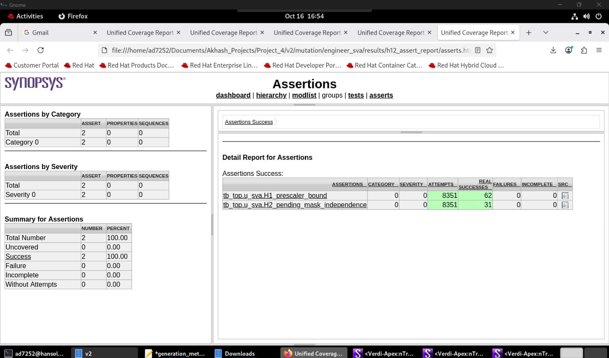

See [supplemental SystemVerilog source](mutation/engineer_sva/engineer_sva.sv) and [reference/M09 run logs](mutation/engineer_sva/results/). The additional properties use guarded, APB-observed history; they are **not general formal proofs** of all timer configurations, and H2's 14 failures are not 14 distinct bug classes.

## Repository guide

| Path | Contents |
|:--|:--|
| [`spec/`](spec/) | Frozen timer requirements and specification hash |
| [`gen/`](gen/) | Generated RTL, original white-box assertions, generation metadata and manifests |
| [`mutation/ref/`](mutation/ref/) | Reference behavioral RTL and same-interface DUT wrapper |
| [`mutation/mutants/`](mutation/mutants/) | All 10 controlled defect implementations and exact edits |
| [`mutation/vectors/`](mutation/vectors/) | 81-test / 8,348-cycle vector stream and test index |
| [`mutation/tb/`](mutation/tb/) | Differential testbench, reference comparison and optional SVA hook |
| [`mutation/scripts/`](mutation/scripts/) | Mutation generation, simulator runners, matrix/audit processing |
| [`mutation/blackbox/`](mutation/blackbox/) | Original port-only generation, hashes, run scripts, analysis and results |
| [`mutation/engineer_sva/`](mutation/engineer_sva/) | Post-experiment H1/H2 assertions and logs |
| [`mutation/results_validation/`](mutation/results_validation/) | Audited original white-box detection report |
| [`mutation/docs/evidence/`](mutation/docs/evidence/) | URG captures and Verdi case-study screenshots |
| [`docs/historical/`](docs/historical/) | Original package README, preserved as historical setup material |

## Reproducing the experiments

**Requirements:** Linux, Bash, Python 3, a licensed Synopsys VCS installation; URG for assertion coverage and Verdi for optional waveform inspection. The project was tested with the **Y-2026.03** VCS/Verdi tool series.

From the **repository root**, verify the immutable source artifacts:

```bash
sha256sum -c gen/GEN_MANIFEST.sha256
(cd gen && sha256sum -c ../mutation/docs/gen_sha256.txt)
(cd mutation/blackbox && sha256sum -c gen/bb_sha256.txt)
(cd spec && sha256sum -c SPEC_FREEZE.sha256)
```

From `mutation/`, run the corrected white-box flow (scripts produce fresh results under `mutation/results/`):

```bash
cd mutation
export TB_DEFINES="+define+CLK_START_1NS"
./scripts/run_ref_check.sh
./scripts/run_all.sh
```

For the independent black-box checker flow, consult [the black-box runner instructions](mutation/blackbox/docs/RUNNER.md) and its frozen [generation prompt](mutation/blackbox/prompt/BB_PROMPT.txt). Use `mutation/blackbox/scripts/run_bb.sh` with the documented run-mode arguments; don't substitute black-box checkers into the white-box-only `WITH_SVA` hook.

**Important:** The archived [initial mutation package README](docs/historical/INITIAL_MUTATION_README.md) describes a *pre-VCS* delivery state. It is preserved for provenance, **not** a current results statement. The final adjudicated matrices linked above are authoritative. Large `simv`, `.vdb`, `.fsdb` and `.vcd` build products are intentionally excluded from this repository.

<details>
<summary><strong>Generation integrity and provenance</strong></summary>

- Original white-box RTL/SVA: [generation manifest](gen/GEN_MANIFEST.sha256) and [generation metadata](gen/generation_metadata.md).
- Original black-box SVA and raw responses: [black-box manifest](mutation/blackbox/gen/bb_sha256.txt) and [black-box provenance](mutation/blackbox/gen/GEN_PROVENANCE.md).
- Frozen black-box prompt: [prompt SHA-256](mutation/blackbox/prompt/BB_PROMPT.sha256).
- The original generation sources were preserved first-pass; later source additions are housed separately.
- Exact model-subversion labels and some session metadata in the historical provenance records have **not** been independently verified; these fields should not be treated as confirmed experimental controls.

</details>

## Threats to validity and interpretation

| Limitation | Consequence |
|:--|:--|
| One checker set per model per contract | No estimate of run-to-run model variability |
| Different white-box/black-box prompts and modeling rules | Cannot isolate **visibility** as the causal variable |
| Mutants selected after white-box checker generation | Potential selection bias toward defects the white-box suites can detect |
| Ten hand-picked timer/interrupt-centered mutations | Not representative of every APB protocol or RTL failure mode |
| Reference, stimulus and infrastructure share Claude Opus assistance | Common-mode interpretation/modeling errors remain possible |
| Port-observable denominator depends on this vector set | M04 is not universally unobservable; it was unobservable at the sampled points here |
| Mutants and stimulus co-developed | Detection rates should not be interpreted as unbiased generalization |
| Assertion successes measured by URG | Evidence of exercise, not evidence of assertion strength or full coverage |
| Supplemental H1/H2 built after examining misses | Illustrative targeted fixes, **not** independent blind evaluation |

The defensible conclusion is narrower and more useful than “model X is better”: **reference-clean assertions can miss real, port-observable RTL defects; mutation-based testing, coverage analysis and waveform debugging expose those gaps.**

## Development and authorship

This is an **LLM-assisted verification experiment with real EDA-tool execution and audit evidence**.

- **Original generated RTL and SVA:** GPT and Claude in separate generation contexts. The white-box and black-box checker artifacts are preserved in the repository.
- **Experiment infrastructure:** Substantial Claude Opus assistance in specification modeling, reference construction, mutation and vector generation, testbench and automation, and root-cause replay.
- **Supplemental H1/H2:** Developed with ChatGPT assistance; source and VCS/URG evidence preserved separately.
- **Project integration and validation:** The project operator executed the Synopsys VCS runs, inspected coverage in URG, debugged cases in Verdi, checked artifact hashes, and curated the technical evidence.

The original generated testbench/reference and mutants are **not presented as independently hand-written**. Measured simulator results are explicitly distinguished from replay-model inference and interpretation.

## Takeaway

A strong verification flow must test **the checker**, not merely the DUT. This project combines reproducible RTL mutation, reference comparison, assertion exercise analysis, failure attribution and targeted APB/interrupt debugging to examine when generated SVA is reliable and when it is not.

---

## 👤 Author

**D. Akhash Krishna**

GitHub: [AKHASHHH](https://github.com/AKHASHHH) · Project: [LLM-Generated-SVA-Mutation-Based-Verification](https://github.com/AKHASHHH/LLM-Generated-SVA-Mutation-Based-Verification)
